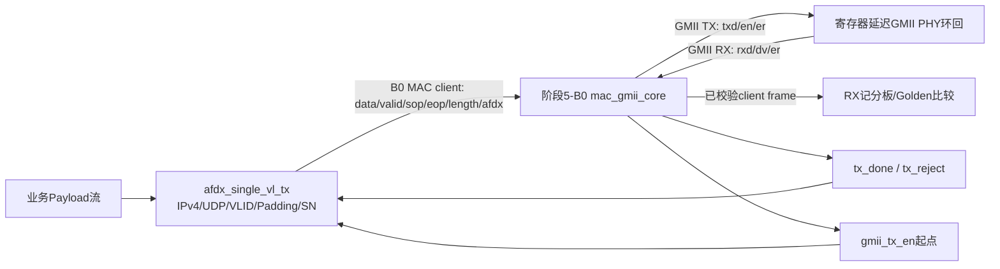

# 阶段5-B1：单VL AFDX发送协议开发与验收报告

报告日期：2026-10-11  
工作目录：`D:\FPGA\captain_integration\stage5B1_single_vl_20261010`

## 当前结论（队长已审核通过）

官方GUI综合、真实功能VO导出、基础和完整网表复验，以及全部B1 RTL和阶段1/2/3-B2/5-B0历史回归已通过。队长于2026-10-11审核并批准已验证的单VL发送功能范围，`STAGE5B1_RESULT=PASS`。

`runs/netlist_004`于2026-10-11 00:08:38结束，退出码0，原始transcript显示`Errors: 0, Warnings: 0`。同一次运行完成256帧SN回绕、真实125 MHz/125000周期BAG、异常恢复与末尾FIFO压力/恢复断言；没有force、修改综合网表或降低验收要求。

| 项目 | 状态 | 证据/边界 |
|---|---|---|
| B1协议RTL、真实B0 MAC/GMII、BAG/SN、异常恢复 | PASS | 本轮`acceptance_003`及其引用的实际仿真 |
| 阶段1/2/3-B2/5-B0历史回归 | PASS | 本轮阶段3-B2 `run_014`、B0 `acceptance_005` |
| B1官方GUI综合 | PASS | 实际0 errors、18 warnings，VQM/数据库/Pack及资源报告均归档 |
| 功能VO导出 | PASS | 真实3,827,515字节VO；EP1S80/Stratix兼容模型身份如实记录 |
| 基础真实网表功能测试 | PASS | `netlist_002`、`005`、`006`、`007`均逐字节通过；7帧、1959个GMII字节 |
| 完整真实网表功能测试 | PASS | `netlist_004`；原始PASS标记、退出码0、271帧/22771个GMII字节及273帧RX比较 |
| CSG225诊断顶层I/O适配 | INCOMPATIBLE | 300输入+279输出=579，超过CSG225总焊球数 |
| `POST_SYNTH_TIMING` | NOT VERIFIED | 没有Setup/Hold证据，8 ns解析不等于时序通过 |
| `EQ6_NATIVE_NETLIST_EQUIVALENCE` | NOT VERIFIED | GUI/Pack为EQ6，EDA功能VO为EP1S80/Stratix；待官方确认 |
| Implementation / Bitstream / 下载 | NOT RUN | 本轮未执行 |
| `STAGE5B1_RESULT` | PASS | 队长已审核；仅限已验证的单VL发送功能范围 |

机器可读当前状态见 [current_status.json](D:/FPGA/captain_integration/stage5B1_single_vl_20261010/runs/current_status.json)。原始网表日志、退出码、WLF和字节CSV是完整测试的证明；状态文件只是汇总。原GUI综合前版本已保存在`evidence/pre_gui_report_001.md`。

## 实现结构



正式八端口 `AFDX_top` 未改动。新增的 `afdx_network_tx_top` 是独立协议/系统级验证顶层，供B1业务描述符、Payload和真实B0 MAC/GMII路径使用；它不替代正式比赛顶层，也没有新增端口到正式 `AFDX_top`。

新增生产RTL：

| 文件 | 职责 |
|---|---|
| [afdx_ipv4_checksum.v](D:/FPGA/captain_integration/stage5B1_single_vl_20261010/rtl/afdx_ipv4_checksum.v) | 对20字节IPv4头计算16位反码校验和 |
| [afdx_bag_gate.v](D:/FPGA/captain_integration/stage5B1_single_vl_20261010/rtl/afdx_bag_gate.v) | 以真实GMII `tx_en`上升沿为发送起点，门控下一帧并统计超出BAG+jitter的迟到 |
| [afdx_single_vl_tx.v](D:/FPGA/captain_integration/stage5B1_single_vl_20261010/rtl/afdx_single_vl_tx.v) | 单VL的Ethernet/IPv4/UDP/Payload/Padding/SN构帧、MAC握手、SN推进和异常取消 |
| [afdx_network_tx_top.v](D:/FPGA/captain_integration/stage5B1_single_vl_20261010/rtl/afdx_network_tx_top.v) | 将B1发送模块与未修改的B0生产MAC连接，暴露GMII及RX观测接口 |

B0生产MAC源码保持不变。B1按原生 `tx_valid/tx_ready`、`tx_sop`、`tx_eop`、`tx_length`、`tx_afdx` 接口提交完整客户端帧。`tx_afdx=1`表示Padding已由B1准备；B0 MAC负责Preamble、SFD、FCS和IFG，不重复补零。B1在MAC `tx_done`后才递增SN；MAC拒绝或B1取消均不递增。

## 冻结帧格式实现

客户端帧从目的MAC地址开始，到SN结束；不包含Preamble、SFD或FCS。

| 顺序 | 字段 | 长度 | 本版处理 |
|---:|---|---:|---|
| 1 | 目的MAC | 6字节 | `DA_CONST[31:0]`后接16位VLID；测试值为 `03:00:00:00:12:34` |
| 2 | 源MAC | 6字节 | 由描述符提供；拒绝组播源地址 |
| 3 | EtherType | 2字节 | `0x0800` |
| 4 | IPv4头 | 20字节 | 固定IHL=5、总长度`28+P`、ID=0、DF=1、TTL由描述符提供、Protocol=17、头校验和正确 |
| 5 | UDP头 | 8字节 | UDP长度`8+P`、首版UDP checksum固定0 |
| 6 | Payload | P字节 | `1≤P≤1471` |
| 7 | Padding | `Q=max(0,17-P)`字节 | 全0，位于SN之前；Payload短于17字节时补齐 |
| 8 | AFDX SN | 1字节 | 普通帧1～255；255后回到1；不发送SN=0复位通知 |
| 9 | Ethernet FCS | 4字节 | B0 MAC对DA至SN生成并按线上字节序发送 |

客户端长度为`43+P+Q`，范围60～1514字节。线路Golden由独立Python标准库实现：IPv4 checksum使用独立反码求和，FCS使用`zlib.crc32`，没有复用RTL计算函数。B0 MAC为未设置AFDX标志的通用帧提供的自动Padding在本链路中关闭，避免重复补零。

这只是批准的单VL IPv4/UDP功能子集，不构成完整ARINC 664 Part 7合规声明。

## 验收证据

ModelSim为本机 **SE-64 2020.4**。每个运行目录保存输入源码快照、SHA-256、`.do`、transcript、console log、WLF和summary；关键仿真同时输出GMII/RX字节CSV。

| 测试 | 结果 | 本轮证据 |
|---|---|---|
| MAC ready背压与保持 | PASS | [stall_003](D:/FPGA/captain_integration/stage5B1_single_vl_20261010/runs/stall_003/summary.json)：5帧客户端字节逐一对照Golden；停顿1003周期，保持断言1003次 |
| 真实MAC/GMII整机闭环 | PASS | [gmii_011 transcript](D:/FPGA/captain_integration/stage5B1_single_vl_20261010/runs/gmii_011/transcript.log)、[WLF](D:/FPGA/captain_integration/stage5B1_single_vl_20261010/runs/gmii_011/waves.wlf)、[GMII字节CSV](D:/FPGA/captain_integration/stage5B1_single_vl_20261010/runs/gmii_011/actual_tx_gmii.csv)、[RX字节CSV](D:/FPGA/captain_integration/stage5B1_single_vl_20261010/runs/gmii_011/actual_rx_client.csv) |
| 125 MHz参数与1 ms BAG | PASS | [clk125_006 transcript](D:/FPGA/captain_integration/stage5B1_single_vl_20261010/runs/clk125_006/transcript.log)：8 ns仿真时钟、`CLK_HZ=125000000`、BAG=125000周期；5种长度、取消恢复、reset恢复 |
| B0半帧取消契约 | PASS | [abort_003 transcript](D:/FPGA/captain_integration/stage5B1_single_vl_20261010/runs/abort_003/transcript.log)：两次中止，无中途全局reset，后续合法帧完成 |
| 阶段1/2/3-B2/5-B0全量回归 | PASS | [acceptance_003 summary](D:/FPGA/captain_integration/stage5B1_single_vl_20261010/runs/acceptance_003/summary.json)、[阶段3-B2 run_014](D:/FPGA/captain_integration/stage3B2_20261008/runs/run_014/summary.json)、[阶段5-B0 acceptance_005](D:/FPGA/captain_integration/stage5B0_selfmac_20261010/runs/acceptance_005/summary.json) |

`gmii_011` 覆盖结果：11种Payload边界长度（1、16、17、18、1471、2、7、64、255、512、1024）；6个无效描述符（P=0、P=1472、非法目的地址、组播源MAC、TTL=0、非法BAG）；3种异常Payload（提前结束、长度超出、显式取消）；错误后恢复帧；reset后完整发送SN=1…255、1；另以零jitter验证真实MAC启动延迟会累计迟到计数。`msg_done`共270次且每次单周期。

最终真实GMII/RX计数为270个Golden帧、22698个GMII字节，其中包括正常边界、恢复帧、256帧SN回绕和两帧迟到策略测试；`late_count=2`。reset后MAC统计器清零，所以末态`tx_sent=258`、`rx_good=258`、`rx_delivered=258`；`tx_rejected=0`、`rx_drop=0`。测试开始到reset前，3个损坏Payload均被MAC拒绝，未产生GMII帧，也没有误推进SN；恢复帧使用预期SN=12。

## 失败记录与修正

- `gmii_001`～`gmii_003`发现的是Testbench GMII计数器在同一时钟沿同时清零和递增，第二帧从上一帧的72继续计数。记分板已改为起始沿直接比较字节0；之后的真实GMII比较和完整RX回环均通过。不是生产MAC多发字节。
- `gmii_004`发现末态期望计数没有区分“仿真期累计波形数”和“reset后MAC硬件计数器”。测试期望已按两者各自计数边界修正，帧数据和协议期望未降低。
- `clk125_001`只因Testbench超时常量超出ModelSim默认32位整数范围而未编译；已缩小为足够大的合法超时并重跑，`clk125_006`通过。
- `acceptance_001`因PowerShell函数参数名与自动变量`$Args`冲突，实际只启动交互提示符。该目录已保留并标记`INVALID_RUNNER_INVOCATION`，不计入PASS。脚本已修复，`acceptance_002`才是有效的一键验收运行。

没有发现需要修改B0生产MAC或冻结RTL才能解决的功能问题。阶段5-B0原始RTL及eLinx模型未修改。

## 官方GUI综合、资源和Warning审计

真实工程为 [AFDXNetwork.epr](D:/FPGA/captain_integration/stage5B1_single_vl_20261010/runs/elinx_001/AFDXNetwork/AFDXNetwork.epr)。综合成功后共116份实际工程、VQM、数据库、Pack、约束和报告文件已按原文件与归档文件哈希一致性保存至 [gui_success_001](D:/FPGA/captain_integration/stage5B1_single_vl_20261010/evidence/gui_success_001/artifact_hashes.json)，同时保存队长截图。项目清单中的全部原源码和综合快照哈希仍一致。

| 阶段 | 实际资源 | 含义 |
|---|---|---|
| 前级综合 | 2490 logic cells、1304 registers、49152 memory bits、24 RAM segments、579 I/O | 前级统计，不当作最终物理资源 |
| eLinx Pack综合映射 | 2491 LUT、1304 FF、369 CLB、12 Memory、579 Pins；DSP/PLL=0 | 真实综合映射报告，未经布局布线 |
| 帧存储 | TX bank、RX bank0、RX bank1，各2048×8 | 三份实际生产FIFO/RAM保留 |

sender、BAG、IPv4 checksum、MAC TX/RX、CRC及帧存储均保留；父子层级统计不重复相加。18条Warning分为：case缺default 1条、位宽截断12条、RAM读写穿透3条、常量输出汇总和明细2条。唯一明确列出的常量输出`gmii_tx_er=0`符合生产设计。具体源码范围、RAM验证要求和信息级环路提示见 [综合Warning与封装I/O审计](D:/FPGA/captain_integration/stage5B1_single_vl_20261010/阶段5-B1-N_综合Warning与封装I_O审计.md)。没有据警告擅自修改B0生产RTL，也没有宣称最终静态环路已验证。

实际EPR、cluster XML和Pack Tcl分别确认顶层、EQ6HL45和CSG225。EDC为`create_clock -name gmii_clk -period 8.000 -waveform {0.000 4.000} [get_ports clk]`；Pack解析与clocklist有实际记录。没有编造外部input/output delay，没有取得有效Setup/Hold报告。

579个外部I/O无法直接适配CSG225；当前诊断顶层仅用于综合和可观察的功能验收。后续正式硬件集成应另行批准内部配置、诊断总线、PHY及引脚方案，本轮不改生产接口。

## 真实功能网表导出与ModelSim复验

在独立工程副本调用安装内EDA Writer，只执行功能网表导出：

```text
quartus_eda.exe --read_settings_files=on --write_settings_files=off --simulation=on --functional=on --tool=modelsim --format=verilog AFDXNetwork
```

实际产物 [afdx_network_tx_top.vo](D:/FPGA/captain_integration/stage5B1_single_vl_20261010/runs/eda_export_001/afdx_network_tx_top.vo)，导出日志和命令见同目录`export.log`及`provenance.json`。

```text
bytes = 3827515
SHA-256 = 76de54156426080cf3a9a70ceaa7eb7e4244e55765fd0cc2eaa6882f3b945cb5
```

VO头部与导出日志选择EP1S80F1508C6/Stratix；不能冒充EQ6器件原生功能模型。没有SDF，没有运行Implementation。

ModelSim SE-64 2020.4只编译真实VO、官方未修改的`altera_primitives.v`、`220model.v`、`stratix_atoms.v`及网表TB；不编译B0/B1 RTL作为DUT。每个目录独立编译库并保存输入快照、哈希、命令、transcript、WLF及字节CSV。

| 实际运行 | 结果 | 覆盖或修复 |
|---|---|---|
| `netlist_001` | FAIL | 波形日志命令访问优化掉的TB信号，测试未开始；保留失败 |
| `netlist_002` | PASS | 原语默认行为，P=1/16/17/18/1471、Padding/SN/FCS、IP checksum、真实BAG、取消后恢复、RX暂停、reset；7帧1959字节 |
| `netlist_003` | FAIL | Tcl优化参数引用错误，未进入功能测试；改为显式vopt后重测 |
| `netlist_004` | PASS | 全套边界、6个无效描述符、3种异常Payload、256帧SN回绕、迟到计数、双RX bank压力及恢复；退出码0 |
| `netlist_005` | PASS | 同一VO使用ModelSim官方零延迟功能选项；与002的GMII/RX CSV逐字节及周期完全一致，仅功能对比 |
| `netlist_006` | PASS | 正常原语模式，调整可见性和优化选项；保留真实波形 |
| `netlist_007` | PASS | 去除信号保留的性能诊断；全部基础断言/CSV仍执行，但该运行没有完整信号WLF，不充当波形证据 |

`netlist_004`末尾FIFO压力测试实测：暂停消费时两帧保留、第三帧明确丢弃且计数+1，恢复消费后再次正常收发。原始标记为`B1_NETLIST_FIFO_PRESSURE = PASS retained=2 dropped=1 recovery=1`。故意溢出检测通过不表示通信无损。

完整测试实测271个TX帧、22771个GMII字节、273个RX已比较帧、完整256帧SN回绕、`late_count=2`及明确丢弃1帧。TX CSV有22771条数据记录和271次帧首字节；RX CSV有273次帧首字节。CSV的`frame_index`在压力场景复用Golden编号，因此不能以唯一编号数代替实际帧数。reset后的末态MAC计数为`tx_sent=259`、`tx_rejected=0`、`rx_seen=262`、`rx_good=261`、`rx_drop=1`、`rx_delivered=261`，与完整测试的跨reset累计帧数口径不同。

[netlist_004原始transcript](D:/FPGA/captain_integration/stage5B1_single_vl_20261010/runs/netlist_004/transcript.log)有`B1_POST_SYNTH_NETLIST_FULL = PASS boundaries=11 rejected_descriptors=6 malformed_payloads=3 sn_wrap_frames=256 fifo_pressure=1 wire_bytes=22771 rx_checked=273 late_count=2`、`Errors: 0, Warnings: 0`，且无`** Error`或`** Fatal`。[summary.json](D:/FPGA/captain_integration/stage5B1_single_vl_20261010/runs/netlist_004/summary.json)记录ModelSim SE-64 2020.4和退出码0。原始[WLF](D:/FPGA/captain_integration/stage5B1_single_vl_20261010/runs/netlist_004/waves.wlf)为106496字节，SHA-256为`55f2c67d8f704000a6dc1b46fdee6cefa3e5fb9ee7bb70e6a0d75ed88a09e772`；[GMII CSV](D:/FPGA/captain_integration/stage5B1_single_vl_20261010/runs/netlist_004/actual_tx_gmii.csv)与[RX CSV](D:/FPGA/captain_integration/stage5B1_single_vl_20261010/runs/netlist_004/actual_rx_client.csv)均保留。

[provenance.json](D:/FPGA/captain_integration/stage5B1_single_vl_20261010/runs/netlist_004/provenance.json)所列VO、Testbench、三份原语库与其运行快照哈希全部重新计算一致；Golden清单及`golden/sha256.json`列出的六份文件哈希也全部一致。VO SHA-256仍为`76de54156426080cf3a9a70ceaa7eb7e4244e55765fd0cc2eaa6882f3b945cb5`。

附加性能诊断`netlist_probe_001`因Tcl查询命令无效而停止，已保留，不计入功能PASS。零延迟功能模式另外触发官方原语库的vopt赋值调度Warning；没有修改原语库，不作为时序或原生器件等价证据。

## 自动化与亲自复验

新手指南见 [阶段5-B1-N_队长功能网表复验指南](D:/FPGA/captain_integration/stage5B1_single_vl_20261010/阶段5-B1-N_队长功能网表复验指南.md)。

```powershell
Set-Location -LiteralPath 'D:\FPGA\captain_integration\stage5B1_single_vl_20261010'
.\run_stage5b1.ps1
# 已有GUI综合预检通过后，单独重新跑完整功能网表：
$taskPython = Join-Path $env:USERPROFILE '.cache\codex-runtimes\codex-primary-runtime\dependencies\python\python.exe'
& $taskPython -B .\scripts\run_b1_netlist.py .\runs\eda_export_001\afdx_network_tx_top.vo --suite full
& $taskPython -B .\scripts\write_current_status.py
```

完整网表SN回绕按125000周期BAG实际运行数千万个时钟周期，本次运行耗时5小时57分19秒。复验时进度见`frame_progress.csv`；已有完整运行未结束时不要重复启动另一份。

`run_stage5b1_n.ps1`将历史回归、GUI成功预检、功能导出、完整网表复验和状态汇总串联起来，不会运行Synthesis或Implementation。当前各子步骤已按上述实际记录执行，包装入口仅完成语法检查，不能描述为另一次完整一键运行。任何关键FAIL均阻止总PASS；本次总PASS还依据队长2026-10-11的明确批准。

## 范围外与遗留事项

- 本版只实现单VL发送，不实现AFDX接收协议、多VL调度、SNMP、615A、RTC、冗余网络或完整配置/管理。
- UDP checksum按批准子集固定为0；不发送SN=0复位通知帧。
- Payload源需遵守`payload_valid/payload_ready`握手；长度不符时上游须继续结束被排空的Payload，或发出取消。无穷期不结束的上游流没有自动超时器。
- 125 MHz/8 ns只用于逻辑仿真与eLinx综合输入，不是布局布线时序结果，不代表100 Mbps或2 ms指标通过。
- 官方八端口AFDX_top没有帧起止与长度字段；如何把该单VL协议功能挂入正式比赛顶层，仍须在后续正式集成阶段解决，本报告的独立网络顶层不能替代该工作。
- 579个诊断I/O不能适配CSG225，是后续正式顶层集成的必要整改项；本轮不改已通过的生产模块。
- 不执行Implementation、Bitstream或硬件下载。

## 官方VO教程补充复审及操作边界

2023-06-05官方教程已只读审查，适用性结论见 [官方VO教程适用性与B1接续审查](D:/FPGA/captain_integration/stage5B1_single_vl_20261010/阶段5_官方VO教程适用性与B1接续审查.md)。其中包含Implementation/SDF的分支本轮未执行；本次使用已经实际验证的综合数据库→功能EDA网表导出分支，保留自研MAC路线。

本轮只修复新增Testbench、网表运行脚本、汇总脚本及文档。B0 MAC、原五份冻结RTL、队友源码、正式AFDX_top和历史验收证据均未修改。GUI工程产物归档后不回写，EDA导出使用独立副本。未调用厂商MAC IP，未执行Implementation、Bitstream或下载，未进入5-B2。

## 队长审核与后续边界

本次完整真实网表已通过，最终PASS标记、计数、SN回绕、FIFO压力、WLF、CSV与输入哈希均已核对。队长已批准阶段5-B1的单VL发送功能验收，`STAGE5B1_RESULT=PASS`；这一结论不扩展到接收协议、正式八端口集成或物理实现。`POST_SYNTH_TIMING`与`EQ6_NATIVE_NETLIST_EQUIVALENCE`保持`NOT VERIFIED`。579个诊断I/O与CSG225不兼容、正式八端口集成及器件时序仍是后续独立整改和验收事项。

批准后的源码、脚本和本报告冻结在本目录独立Git仓库的`stage5b1-approved-2026-10-11`标签。`B1_FREEZE_MANIFEST.json`记录B1源码、冻结依赖、最终报告与原始证据的SHA-256；大型仿真产物仍保留在原运行目录，不由Git复制或重跑。
