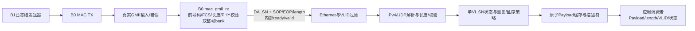

# 阶段5-B2：AFDX接收协议与正式顶层集成审计计划

**当前接续状态（2026-10-11）：** B2-1/B2-2及SN工程规则已获队长授权并完成完整RTL/真实GMII协议闭环验收，结果见正式开发验收报告，阶段结论待最终审核。以下内容保留为开发前计划；其中待批准SN和半环窗口建议均已由批准后的SN冻结表取代。B2-3/B2-4尚未授权执行。

日期：2026-10-11（Asia/Shanghai）  
状态：**设计待队长审核；未开始B2生产RTL**  
范围：单VL接收协议、真实发送与接收协议闭环，以及正式八端口集成方案的审计。多VL、冗余网络、SNMP、615A和RTC不在B2首版功能验收内，也不能因此宣称完整ARINC 664 Part 7合规。

**2026-10-11接续说明：** 队长已批准B2-1/B2-2中不依赖SN最终决策的开发。本文第4节原“半环窗口”仅为历史设计建议，现由[SN状态转换待审核表](D:/FPGA/captain_integration/stage5B2_rx_arch_20261011/阶段5-B2_SN状态转换待审核.md)取代；原则上倾向XAPP1130的`PSN+1/+2`完整性规则，但未获生产批准。正式八端口定义仍待官方答复，不阻断独立协议核心与真实MAC闭环。

## 1. 审计结论与开发门槛

阶段5-B1已由队长审核通过，`STAGE5B1_RESULT=PASS`只覆盖已验证的单VL发送功能。B1冻结Git标签为`stage5b1-approved-2026-10-11`，提交为`302b944afc111aa232688d700911704d667c7a37`；[冻结清单](D:/FPGA/captain_integration/stage5B1_single_vl_20261010/B1_FREEZE_MANIFEST.json)保存源码、B0与正式顶层依赖、报告及原始网表证据的SHA-256。B1完整网表测试已通过，本计划不重跑。

**B2可先开发和验证独立的MAC客户帧接收协议层；在正式八端口的字节层次、帧边界、业务来源及配置方式冻结之前，不能宣称`AFDX_top`已经实现真正的AFDX协议闭环。** 本轮只制定方案，不创建生产RTL、TB或eLinx工程。

```text
STAGE5B1_RESULT = PASS（已验证的单VL发送功能）
STAGE5B2_DESIGN = PENDING_CAPTAIN_REVIEW
STAGE5B2_RTL = NOT STARTED
POST_SYNTH_TIMING = NOT VERIFIED
EQ6_NATIVE_NETLIST_EQUIVALENCE = NOT VERIFIED
DIAGNOSTIC_IO_FIT = INCOMPATIBLE（579个诊断I/O与CSG225）
IMPLEMENTATION = NOT RUN
BITSTREAM = NOT RUN
```

## 2. 依据与可信范围

| 依据 | 可确认的内容 | 不能据此确认的内容 |
|---|---|---|
| [2026中科亿海微选题指南](</D:/FPGA/全国大学生嵌入式芯片与系统设计竞赛'2026FPGA赛道选题指南-中科亿海微.pdf>)，PDF第4–6页/印刷第2–4页，SHA-256 `73e44600d609799a373eb84669bcaa75bba1f070e84fc2212accba37ed849afb` | 选题要求以MAC为基础完成UDP/IP、缓冲、发送调度与接收管理；技术指标列100 Mbps、VLID、SN 1–255、通常≤1471字节Payload、总帧长≤1518字节；规定八端口模板 | 模板注释没有定义`tx_data/rx_data`对应GMII线上字节、DA..SN客户帧还是Payload；没有SOP/EOP、长度或配置入口 |
| [官方群答疑归档](D:/FPGA/captain_integration/stage3A_20261008/evidence/official_group_questions_1008.json)，原表`FPGA创新大赛问题汇总1008.xlsx` SHA-256 `375c209da138bce1e7e7a0d16f2eb399e09c085fadd95885b529d6fbe73de2f4` | Sheet1行2要求参赛者自写激励；行46称使用参赛者TB、综合后仿真即可；行50、62允许valid-only，`rx_ready`可不用，`tx_ready`取值不作要求；行58要求吞吐率100 Mbps；行60答GMII接口延时不超过2 ms；行61明确GMII是PHY接口 | 行49没有回答线上字节范围、帧边界和长度；行58未定义吞吐的Payload/线上统计口径；行60未给精确起止事件与抖动统计；群答疑身份沿用队长提供资料，未独立验证答复者 |
| [冻结八端口AFDX_top](D:/FPGA/captain_integration/stage3B2_20261008/rtl/AFDX_top.v)，SHA-256 `58a7ca69e526ec569177b98618043fe4f434a464c883382fae9548ebc9c28953` | `rx_data/rx_valid`为输入、`tx_data/tx_valid`为输出；外部valid-only；`tx_ready=0`、`rx_ready`不参与；内部目前为字节FIFO与空core shell | 现有正式顶层没有真实MAC、B1发送器、接收协议parser或业务生产者，不能凭B1诊断顶层PASS称正式接口已集成 |
| [B0 MAC生产源码](D:/FPGA/captain_integration/stage5B0_selfmac_20261010/rtl/mac_gmii_core.v)及[RX实现](D:/FPGA/captain_integration/stage5B0_selfmac_20261010/rtl/mac_gmii_rx.v)，RX SHA-256 `b2c3d4cfd8e7e70251df01bc063ed0ccbb65878c85b4c7a3a8038cbb62466849` | B0从GMII校验Preamble/SFD、长度、PHY错误与FCS；只有完整合法帧才经双2048字节bank输出DA..SN客户帧，附`rx_sop/rx_eop/rx_length`和内部ready/valid | B0不检查VLID、IPv4/UDP、SN或应用Payload；两个bank不足时已有明确drop，不能视为无限接收缓存 |
| [B1发送RTL](D:/FPGA/captain_integration/stage5B1_single_vl_20261010/rtl/afdx_single_vl_tx.v)及[集成诊断顶层](D:/FPGA/captain_integration/stage5B1_single_vl_20261010/rtl/afdx_network_tx_top.v) | 已验收的发送profile为DA(32位前缀+16位VLID)、SA、IPv4固定20字节、UDP固定8字节、P=1..1471、`Q=max(0,17-P)`、Payload→Padding→SN、普通SN 1..255后回1、UDP checksum=0；B0负责FCS | B1诊断顶层的579个I/O不能作为CSG225正式顶层，也未验证AFDX协议接收；B1 `rx_data`输出是B0 MAC客户帧，未经过协议过滤 |

指南与答疑是比赛依据；B0/B1冻结规则是本项目已批准实现范围。对ARINC 664 Part 7更广规则、SN=0通知、冗余去重等不能从本地指南推导为已经验证。

## 3. 最终评测数据方向与正式接口风险

| 问题 | 已确认 | 待确认或待队长决策 | B2处理 |
|---|---|---|---|
| 数据方向 | `AFDX_top.rx_data[7:0]`/`rx_valid`由外部送入；`tx_data[7:0]`/`tx_valid`由设计输出 | 外部八位流位于应用层、MAC客户层还是GMII PHY层 | 在协议核心内部使用B0已定义的DA..SN客户帧接口；正式边界只做方案，不先接线 |
| valid与ready | 官方答疑允许valid-only，`rx_valid=1`采样输入、`tx_valid=1`输出有效；两ready不构成必要握手 | 对方若采用ready时的主体/配对语义未定义 | 维持冻结`tx_ready=0`、`rx_ready`不使用；内部B0和协议缓存仍用ready/valid，不能同名直接映射 |
| 帧边界与长度 | B0 MAC内部提供`rx_sop/rx_eop/rx_length`，TX内部也有SOP/EOP/长度 | 官方八端口没有边界/长度；`valid=0`是否表示帧间隙、字节范围是否含Preamble/SFD/FCS/IFG均未确认 | 正式集成前取得官方澄清或队长批准的可验证字节profile；不能把空拍、固定8字节或TB长度偷作协议边界 |
| 业务来源与配置 | B1诊断顶层有描述符和Payload输入；正式顶层没有这些端口 | 内部应用数据、VL配置、IP/UDP地址与复位装载机制如何进入正式系统 | 对比内部ROM/寄存器配置、受控扩展包装顶层等方案；保持八端口`AFDX_top`接口不变，任何正式接入方案单独审核 |
| GMII与错误信号 | 答疑称GMII是PHY接口；B0需要`gmii_rxd/rx_dv/rx_er` | 官方八端口没有`rx_er`，也没有GMII TX EN等独立端口 | 完整协议闭环先在独立系统顶层验证，正式八端口适配须明确缺失信号的处置与验收能力 |

建议向官方提交一份集中澄清：八端口每个valid字节代表哪一层、一个完整帧的起止和长度如何表达、是否含FCS及Preamble/SFD、低valid间隙是否强制作为EOP、接收PHY错误如何报告、官方是否会驱动真正的GMII或仅调用参赛者TB。若不能得到明确答复，队长须批准一个**明确标为团队约定**的评测profile；该profile通过独立适配器验证，不伪称官方定义。

| 候选八端口解释 | 可以怎样适配 | 关键缺口 |
|---|---|---|
| GMII式线上字节：`rx_valid`相当于RX DV，低电平表示线帧结束 | 适配器将`rx_data/rx_valid`送B0的`gmii_rxd/rx_dv`，从B0 TX GMII取`tx_data/tx_valid` | 官方未确认此解释；八端口缺少`rx_er`，无法从该边界证明PHY错误处理；还须明确IFG不作为有效数据字节 |
| MAC客户帧：只传DA..SN | 接收器可依据IPv4 Total Length估算正常帧长度，发送端省略FCS | 错误头或中途截断时无法可靠重同步；没有官方EOP规则和FCS责任说明，不能作为默认方案 |
| 应用Payload字节 | 需要内部应用流与独立MAC/PHY接口 | 八端口没有Payload长度、VL配置、MAC/PHY信号；无法仅凭现有端口证明完整系统可达 |

目前建议先使用B0明确的内部客户帧接口开发B2接收核心；**不选择任何一项候选八端口解释作为已确认事实**。

## 4. B2接收架构草案



1. **MAC边界。** 原样复用B0生产MAC。接收协议层只消费B0已完成FCS验证的客户帧；`rx_sop`、`rx_eop`、`rx_length`与`rx_valid && rx_ready`共同定义一次内部帧事务。B0的`rx_dropped/drop_reason`与B2协议拒绝计数分别记录，不把损坏FCS误算成协议拒绝。
2. **Ethernet/VLID。** 检查DA的配置前缀及16位VLID、SA合法性、EtherType=`0800`；仅接受配置的单VL。DA完整匹配规则、允许的SA白名单与组播地址位由配置锁存；未知VLID和错误EtherType整帧丢弃，绝不进入SN状态。
3. **IPv4。** 首版仅接收IPv4版本4、IHL=5、无选项、Protocol=17、非分片、TTL非0及配置的源/目的地址；与B1互通时还核对ID=0、DF=1、fragment offset=0。计算20字节头反码和，含checksum后应为`FFFF`。由IPv4 Total Length求`P=TotalLength-28`，限制`1..1471`，与B0客户帧长度相互核对。分片、选项及其他协议在B2首版明确拒绝并计数，不声称全面IPv4实现。
4. **UDP与尾部。** UDP Length必须为`8+P`，端口按配置核对。先按B1互通profile接收checksum字段0；若需接受非0校验和，算法及政策在正式RTL前单独冻结。消费恰好P字节Payload，检查`Q=max(0,17-P)`个零Padding及最后一个SN，且客户帧总长度恰为`43+P+Q`，EOP只落在SN。任何多字节、短帧、长度冲突或非零Padding均拒绝。
5. **SN。** 每VL独立状态，B2单VL实例也保留VL键。普通SN为1..255，255后回1，顺序距离必须在**255个有效值的环**上计算，不能把0当普通业务SN。建议首次合法帧建立基线；相同SN视重复丢弃；后继SN正常接受；前向距离2..127的跳号帧接受并记录缺号；距离128..254视旧号/倒退而丢弃并计数。严格丢弃所有非连续帧会在丢包后长期失步，因此不作为默认建议。这个半环窗口规则只是**待批准的工程策略**，SN=0复位通知、超时重同步、双网络冗余及安全认证窗口仍需依据正式标准或官方答疑另行确认；未批准前不得编码成生产行为。
6. **原子交付。** 由于SN在帧末，不能边收到Payload边向应用端释放。解析时写入候选Payload bank，全部字段、长度、SN通过后才提交`{VLID, P, Payload, SN, 接收状态}`描述符。建议双Payload bank（每bank至少1471字节）配合B0双整帧bank，允许一帧交付暂停时解析下一帧；第三帧超容量时只允许明确整帧丢弃、计数和恢复，不交付残帧。具体bank数与RAM映射按后续资源实测再冻结。
7. **恢复与计数。** 每个错误帧耗尽或安全取消其B0客户帧事务，释放候选bank；不得只在reset后恢复。分别统计MAC错误、Ethernet/VLID、IPv4、UDP、Padding/长度、SN重复、SN乱序、接收缓存溢出、应用交付和计数饱和。reset取消在途帧并建立新的统计epoch，不把清空算作交付。

内部Parser的`ready`只控制B0已完整缓存帧的释放速度；正式八端口的`rx_ready`不参与。B0两个bank满时第三帧会丢弃，接收缓存容量和最坏应用暂停时间必须在B2验收中分别给出。

## 5. 真正的AFDX发送与接收协议闭环

先建立独立的`afdx_protocol_system_top`概念顶层（**本轮仅设计**）：业务描述符与Payload进入冻结B1发送器，经冻结B0 MAC TX、真实GMII线字节、可控PHY传播/扰动、冻结B0 MAC RX，再进入B2接收解析器与应用Payload消费者。使用真实业务字段而非固定8字节。检查两层数据：GMII线上Golden覆盖前导码、Ethernet/IP/UDP、Padding、SN、FCS；应用Golden只包含合法Payload和元数据。直接把B0 `rx_data`对照B1客户帧，只证明MAC回环，不能计为B2协议闭环。

闭环至少覆盖P=1、16、17、18、1471；连续帧和1..255→1的SN回绕；地址、VLID、端口变化；BAG门控；消费者暂停与恢复；FCS/PHY错误、IPv4校验和错误、UDP长度错误、Padding错误、重复/乱序SN、错误后合法帧恢复。错误注入必须发生在真实GMII字节流或独立构造的合法FCS帧上：修改上层字段后重新计算FCS，才能证明协议过滤而非仅靠B0 FCS拦截。最终断言以应用实际交付字节、帧数、拒绝原因和SN状态为准。

## 6. 正式顶层和封装适配方案

现有`afdx_network_tx_top`是诊断顶层，300输入+279输出=579个I/O，超过CSG225总焊球数225，`DIAGNOSTIC_IO_FIT=INCOMPATIBLE`。不修改B0/B1生产RTL或冻结八端口`AFDX_top`。

| 路径 | 作用 | 限制/审核点 |
|---|---|---|
| 独立协议系统顶层 | 先证实真实MAC→完整协议接收→应用交付闭环；TB可访问完整描述符、GMII和错误元数据 | 只作功能与诊断验收，不能冒充正式八端口或封装可用 |
| 正式八端口适配层 | 在官方或队长冻结的字节profile下，把正式输入转成内部可验证的帧/GMII事务，把发送结果转成正式输出；原八端口名称、方向、位宽不变 | profile未定时不能可靠识别变长帧或处理PHY错误；须单独证明非空TX与RX协议可达，不可只测空壳 |
| 器件/封装集成顶层 | 将高位数配置与统计改为内部寄存器/ROM或低引脚数控制/诊断通道；GMII物理接口、时钟、复位、引脚方案独立审查 | 不把579位直接分配给CSG225；是否能容纳真实PHY与所需控制脚仍待引脚表和物理资源核验，未批准不得实施 |

正式顶层集成前应提供端口位宽逐项预算、CSG225可用用户I/O清单、配置写入与诊断读取路径、独立时钟/复位图和外部测试profile。B1的579位主要来自展开的描述符、Payload、GMII、RX及32位计数；方案目标是移除**顶层诊断外露**，不是删掉内部业务功能或降低验证断言。

## 7. 性能与工具缺口的后续验证路径

| 指标 | 当前证据 | 后续测法和PASS门槛 | 当前状态 |
|---|---|---|---|
| 100 Mbps吞吐 | B1使用125 MHz、8位GMII功能仿真；这对应1 Gbit/s字节时钟能力，不证明100 Mbps有效吞吐 | 在官方确认的接口速率下，用真实业务流及足够长时间窗同时报告线上bit/s、有效Payload bit/s、帧开销、IFG与drop；达到官方明确的100 Mbps口径且无未预期丢帧。答疑只写“吞吐率达到100Mbps”，有效Payload/线速口径仍需确认 | NOT VERIFIED |
| GMII接口延时≤2 ms | B1只验证BAG时钟周期和逻辑正确 | 为每帧在发送提交、GMII首字节/末字节、接收GMII首字节/末字节、应用交付分别打时间戳，报告最大值、分位数与抖动；以官方确认的起止事件和最坏值≤2 ms验收，加入最大帧、队列压力和错误恢复 | NOT VERIFIED |
| Setup/Hold及125 MHz约束 | eLinx Pack解析8 ns；没有有效Setup/Hold报告 | 先确认官方综合后静态时序入口、约束覆盖、时钟/外部I/O延迟与未约束路径；取得真实Setup/Hold和worst slack再判断。若需Implementation/SDF，另请队长批准；本轮不运行 | `POST_SYNTH_TIMING=NOT VERIFIED` |
| EQ6器件原生模型 | GUI/Pack目标EQ6HL45/CSG225，B1功能VO实际为EP1S80/Stratix兼容原语 | 向厂商确认导出映射关系及EQ6原生仿真/等价流程；使用可追溯原生模型或等价证明，检查与同一设计同一激励的一致性 | `EQ6_NATIVE_NETLIST_EQUIVALENCE=NOT VERIFIED` |
| 封装I/O适配 | 579个诊断I/O已证明超过CSG225总焊球数 | 在低引脚数正式集成方案冻结后核对真实用户I/O与PHY需求，并取得合法引脚分配证据；未经批准不实施或下载 | `DIAGNOSTIC_IO_FIT=INCOMPATIBLE` |

## 8. 获批后的单人实施顺序与自动验收

本节是**拟议工作顺序**，不是本轮执行记录。Codex在每个已批准的小阶段内独立开发、运行、定位、修复和复验；保留失败原始目录，使用新编号运行，不由队长承担日常操作。涉及冻结接口/生产模块、官方profile变更、Implementation和硬件动作时停止并单独申请批准。

| 顺序 | 拟交付 | 自动化验收条件 |
|---|---|---|
| B2-0 契约冻结 | 官方澄清与队长对SN策略、地址/端口、UDP checksum、正式字节profile及业务配置的决议 | 每项有来源、版本、明确值和负例；未决项不伪装已冻结，依赖项阻止对应正式RTL |
| B2-1 接收核心与Golden | 新目录中的RX parser、SN状态、候选缓存和独立Python Golden；不改B0/B1 | 单元仿真覆盖所有字段、P边界、校验和、Padding/SN、长度截断/超长、重复/乱序、reset与无全局reset恢复；每个错误精确原因、无坏Payload泄漏；源码/TB/Golden哈希和WLF归档 |
| B2-2 真实协议闭环 | 冻结B1+B0 TX、真实GMII/PHY模型、冻结B0 RX、新B2接收与应用消费者 | 逐字节比较GMII Golden与Payload Golden；在协议层而非仅MAC层检查合法交付；错误注入重新计算FCS以区分MAC和协议过滤；压力前后数量守恒，SN回绕完整运行 |
| B2-3 正式顶层方案实现（另审） | 根据已冻结profile接入原八端口、内部配置与有限I/O适配 | 八端口未改；外部valid-only与内部ready/valid隔离；非空TX/RX真实协议交易通过；I/O位宽预算满足目标封装，不能把诊断顶层冒充正式顶层 |
| B2-4 综合与功能网表（另审） | 官方GUI综合、真实VO与原语、独立网表TB | 0 Error；Warning逐条归类；真实VO哈希与顶层/器件身份记录；协议闭环、错误、SN与缓存压力在网表上重测；RTL PASS不得代替VO PASS |
| B2-5 性能/器件专项（另审） | 吞吐、时延、Setup/Hold、EQ6等价与引脚适配的各自报告 | 每项按第7节单独状态；缺少真实证据保持NOT VERIFIED，不能由功能PASS推导 |

一键验收入口应逐项失败即停止，保存ModelSim版本、真实DUT文件清单、命令、退出码、transcript、WLF、TX/RX/应用CSV、SHA-256、独立Golden输入、资源与Warning报告。至少分开输出`B2_RX_PROTOCOL_RTL`、`B2_PROTOCOL_END_TO_END`、`B2_FORMAL_TOP_INTEGRATION`、`B2_POST_SYNTH_FUNCTIONAL`、`B2_100M_THROUGHPUT`、`B2_GMII_LATENCY`、`POST_SYNTH_TIMING`、`EQ6_NATIVE_NETLIST_EQUIVALENCE`与`DIAGNOSTIC_IO_FIT`；未运行项绝不写PASS。B2总结果须待所有本阶段必需项与队长审核通过才可能PASS，范围外指标单独列示。

## 9. 请求队长确认的决策

1. **正式八端口字节profile。** 是否由队长向官方追问第3节六个边界问题？若官方无明确答复，选择何种团队约定，并限定正式顶层能证明的能力。此项是正式集成的阻塞门槛；独立接收核心方案可先审。
2. **B2首版接收范围。** 是否批准“单VL、IPv4固定20字节、UDP checksum=0、非分片、配置地址/端口匹配、Payload 1..1471”的与B1互通profile？其他合法IPv4/UDP变体应明确记为后续扩展或拒绝规则。
3. **SN策略。** 是否批准第4节的首次合法帧建基线、前跳接受记缺号、重复/旧号丢弃、255值环上半环窗口的工程策略？SN=0、超时重同步及双网络冗余如何处理，需要官方/标准依据或另行决定。
4. **业务与配置来源。** 原八端口没有描述符和Payload入口。需决定内部配置加载、业务生产者和结果消费者的可验证实现方式；不能用固定演示帧替代真实业务链路。
5. **缓存与过载契约。** 是否批准双候选Payload bank和整帧丢弃/计数策略，以及应用暂停上界和容量预算方法？任何故意过载PASS应注明已丢帧。
6. **阶段边界。** 本轮只请求审核架构；批准后才按第8节启动B2正式开发。Implementation、Bitstream、硬件下载、冻结接口或B0/B1生产RTL修改均不在本次授权范围。

**停止点：** B1已冻结；本文件提交设计审核。未得到队长对B2架构及关键契约的批准前，不开始B2生产RTL。
